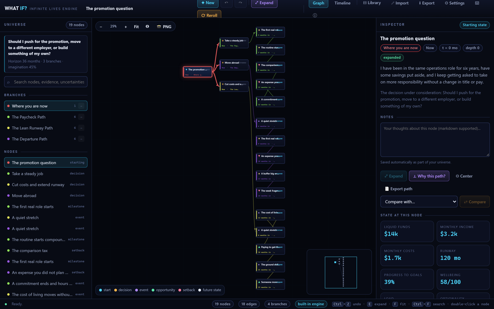
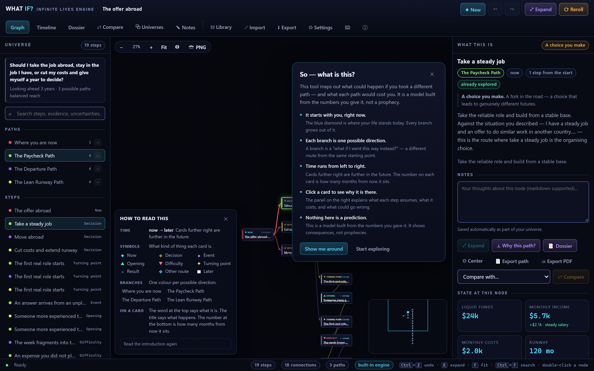
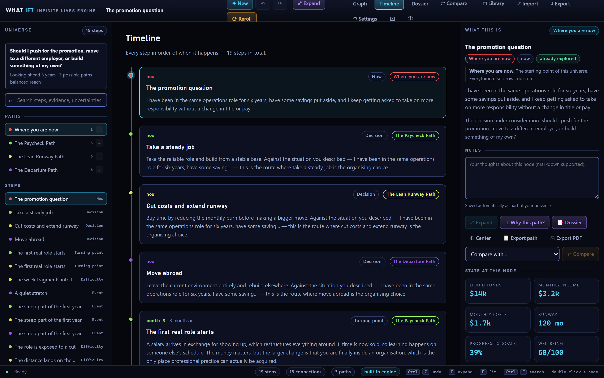
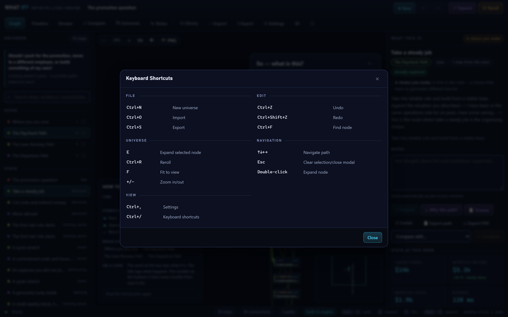

# What If? — The Infinite Lives Engine

[](https://github.com/CypherMorgan/what-if-infinite-lives-engine/actions/workflows/ci.yml)
[](https://github.com/CypherMorgan/what-if-infinite-lives-engine/actions/workflows/release.yml)
[](LICENSE)
[](#requirements)
[](https://www.electronjs.org/)
[](https://react.dev/)
[](https://www.typescriptlang.org/)
[](#testing)
[](#privacy--security)

<p align="center">
  
</p>

A local-first Windows desktop application for exploring plausible alternative life paths through interactive branching timelines, decisions, counterfactuals, and deterministic simulations. It runs fully offline with a built-in rules engine and has an optional OpenAI-compatible provider for richer prose — without sending anything to the network unless you explicitly configure one.

## Screenshots

| Multiverse graph                                                               | Node inspector                                                                             |
| ------------------------------------------------------------------------------ | ------------------------------------------------------------------------------------------ |
|  |  |

| Timeline view                                                    | Keyboard shortcuts                                                 |
| ---------------------------------------------------------------- | ------------------------------------------------------------------ |
|  |  |

> Screenshots are generated from the real app UI by `npm run screenshots` — they are not mockups.

## Features

- **Interactive multiverse graph** — Pan, zoom, drag nodes, select paths, collapse branches, search, minimap, auto-layout. Animated branch growth with reduced-motion support.
- **Deterministic simulation** — Pure rule-engine model over a typed variable/state system. No fake probabilities or hardcoded guesses. "Model spread" is labelled engine variance, not a real-world forecast.
- **Counterfactuals** — Change any assumption or choose a decision option to fork a new universe. Full lineage (parent/counterfactual metadata), snapshots, diffs, and stability analysis.
- **Honest evidence model** — Every node carries evidence tags (`user-fact`, `research`, `assumption`, `speculation`) with provenance so you can tell stated facts from extrapolation.
- **Local-first persistence** — Versioned JSON documents (`schemaVersion: 3`) with migrations, atomic writes, repair-on-import for recoverable issues (dangling edges/unreachable nodes are repaired with notes; structural failures are rejected), and a library index.
- **Import/Export** — Self-contained `.whatif.json` envelope (`format: whatif.universe`) with checksum/hash, schema version, and app version for forward-compatible migration. Export any path as a **Markdown report**, and the graph canvas as a **PNG**.
- **Timeline view** — Toggle between the graph and a chronological timeline sorted by elapsed time, with branch colours and per-node tradeoffs.
- **Node notes** — Attach your own markdown notes to any node; they persist with the universe and appear in path exports.
- **Guided onboarding** — A first-run tour (skippable, remembered) introduces the explorer, graph, and inspector.
- **Privacy by design** — No telemetry, analytics, crash reporting, or accounts. Network access only if you configure an HTTP provider. API keys go through Electron `safeStorage` (DPAPI on Windows), never written to renderer storage, logs, or exports.
- **Windows-native** — Electron app with menus, shortcuts, file dialogs, DPI awareness, NSIS installer + portable build.

## Tech Stack

| Layer           | Technology                                                                                                              | Rationale                                                                                                                                       |
| --------------- | ----------------------------------------------------------------------------------------------------------------------- | ----------------------------------------------------------------------------------------------------------------------------------------------- |
| Desktop shell   | [Electron 44.9.0](https://www.electronjs.org/)                                                                          | Ships a real Windows exe/installer with no C++/.NET/Rust toolchain required on this machine.                                                    |
| UI              | [React 19](https://react.dev/) + [TypeScript 5.9](https://www.typescriptlang.org/) (strict, `noUncheckedIndexedAccess`) | Type-safe, predictable rendering.                                                                                                               |
| Build           | [Vite 7](https://vitejs.dev/)                                                                                           | Fast dev + correct file:// loading (`base: './'`).                                                                                              |
| Packaging       | [electron-builder 26](https://www.electron.build/)                                                                      | NSIS installer + portable Windows builds.                                                                                                       |
| Core/simulation | Hand-written TypeScript                                                                                                 | Deterministic, testable, no native modules (avoids build complexity). Canvas2D graph renderer hand-written for full control over motion/layout. |
| Persistence     | Versioned JSON + migration chain                                                                                        | Atomic writes, portable, auditable.                                                                                                             |

Core modules have no Electron imports so the simulation/graph/AI logic runs in Node for unit tests.

## Requirements

- Windows 10/11 x64
- Node.js 22+ (see [`.nvmrc`](.nvmrc); tested with 26.8.1)
- npm 11+ (tested with 11.19.0)

## Download

Grab a prebuilt binary from the [Releases page](https://github.com/CypherMorgan/what-if-infinite-lives-engine/releases):

- **`What If Infinite Lives Engine-Setup-<version>-x64.exe`** — NSIS installer (per-user, choose your install folder, adds Start Menu + desktop shortcuts).
- **`What If Infinite Lives Engine-Portable-<version>-x64.exe`** — single-file portable build; no installation required.

No runtime, toolchain, or account is needed to run either build.

## Installation & Development

```powershell
# Install dependencies
npm install

# Run in browser (Vite dev server)
npm run dev
# → http://localhost:5199

# Run as desktop app (builds Electron shell first)
npm run dev:desktop

# Typecheck
npm run typecheck

# Lint
npm run lint

# Format (Prettier)
npm run format
npm run format:check

# Run all tests
npm test

# Watch tests
npm run test:watch

# End-to-end smoke tests (Playwright; starts the dev server automatically)
npm run test:e2e

# Regenerate the app icon (build/icon.ico + build/icon-256.png)
npm run icon
npm run icon:verify

# Regenerate the README screenshots (starts the dev server automatically)
npm run screenshots
npm run screenshots:verify
```

## Building for Windows

```powershell
# Build renderer + Electron shell
npm run build

# Create NSIS installer + portable in release/
npm run dist

# Portable only
npm run dist:portable

# Package and publish to GitHub Releases (requires GH_TOKEN; used by CI)
npm run release
```

Outputs:

- `release/What If Infinite Lives Engine-Setup-<version>-x64.exe` — NSIS installer
- `release/What If Infinite Lives Engine-Portable-<version>-x64.exe` — single-file portable build
- `release/win-unpacked/` — unpacked application directory (used while packaging)

Both artifacts are produced by a single `npm run dist`. Releases are published automatically by [`.github/workflows/release.yml`](.github/workflows/release.yml) when a `v*` tag is pushed.

## Project Structure

```
thewhatifs/
├── .github/                  # CI, release workflow, issue/PR templates
├── build/                    # Icon source (icon.ico, icon-256.png)
├── docs/                     # ARCHITECTURE.md + screenshots/
├── e2e/                      # Playwright smoke tests
├── electron/                 # Main + preload (contextBridge API)
│   ├── main.ts
│   └── preload.ts
├── scripts/                  # Build helpers (icon generator, screenshot capture)
├── src/
│   ├── ai/                   # Provider interface, offline/HTTP adapters, orchestrator, schema
│   ├── core/                 # Engine, graph, layout, rules, counterfactuals, migration/import/export
│   │   ├── packs/            # Rule packs + variables
│   │   └── ...
│   ├── ui/                   # React app, Canvas renderer, state store, theme
│   │   ├── components/
│   │   ├── graph/
│   │   ├── state/
│   │   └── theme.css
│   ├── main.tsx
│   └── ui/App.tsx
└── tests/                    # 146 unit tests (engine, counterfactual, persistence, AI)
```

## Usage

1. **Create a universe** (`Ctrl+N`) — Describe your situation and the decision in front of you. The offline engine generates a branching simulation deterministically.
2. **Navigate** — Click nodes to inspect. Use arrow keys to move along paths, `E` to expand, mouse to pan/zoom/drag.
3. **Expand** — `Expand` generates the next plausible steps from a node using the rule catalogue.
4. **Counterfactuals** — Tweak assumptions in the inspector or use "What if…" to fork a new universe. Choose decision options to explore alternatives.
5. **Compare** — Compare any two nodes to see diffs, stability, and noise-sensitive variables.
6. **Import/Export** — `Ctrl+S` / `Ctrl+O` to save/load `.whatif.json` files. Universes are also auto-saved to your library.
7. **Settings** — Configure an OpenAI-compatible provider (base URL/model/keyless). Keys are stored encrypted via `safeStorage` in the app data folder.

## Keyboard Shortcuts

| Shortcut                  | Action                      |
| ------------------------- | --------------------------- |
| `Ctrl+N`                  | New universe                |
| `Ctrl+O`                  | Import                      |
| `Ctrl+S`                  | Export                      |
| `Ctrl+Z` / `Ctrl+Shift+Z` | Undo / Redo                 |
| `Ctrl+F`                  | Fit to view                 |
| `Ctrl+/`                  | Keyboard shortcuts          |
| `E`                       | Expand selected node        |
| `F`                       | Fit to view                 |
| `+` / `-`                 | Zoom in / out               |
| `↑/↓/←/→`                 | Navigate to parent/child    |
| `Esc`                     | Clear selection/close modal |

## Testing

All core logic is covered by unit tests (146 passing):

- **engine.test.ts** — Determinism, expansion, layout, queries, forecast/spread, rule catalogue, derive clamping
- **counterfactual.test.ts** — Assumption/decision counterfactuals, lineage, reroll, snapshots/diffs/stability
- **persistence.test.ts** — Export envelope round-trip, all typed import failures, v1→v3 migrations
- **ai.test.ts** — JSON extraction/parse, HTTP provider (fallback/strict/redaction/cancellation), document coercion

End-to-end smoke tests live in `e2e/` and run with Playwright:

```powershell
npm run test:e2e
```

### Quality tooling

- **TypeScript** — `strict` and `noUncheckedIndexedAccess`; run `npm run typecheck`.
- **ESLint** — flat config with `typescript-eslint`; run `npm run lint`.
- **Prettier** — formatting via `npm run format` / `npm run format:check`.
- **Commitlint + Husky** — conventional-commit messages and a pre-commit typecheck/lint hook.
- **Error boundaries** — the app and its panels fail soft with a recoverable UI.

## Privacy & Security

- **Offline by default** — No network calls unless a provider is configured.
- **No telemetry** — Nothing is collected or sent.
- **Secrets** — API keys encrypted with Windows DPAPI via `safeStorage`, stored in `secrets/` under the app data directory. Never persisted in renderer localStorage or exports.
- **Sandboxed renderer** — `contextIsolation: true`, `nodeIntegration: false`, CSP in `index.html`, navigation/permissions blocked.
- **Local data** — Universes live in `localStorage` and app data; fully user-controlled.

## License

```
MIT License

Copyright (c) 2026

Permission is hereby granted, free of charge, to any person obtaining a copy
of this software and associated documentation files (the "Software"), to deal
in the Software without restriction, including without limitation the rights
to use, copy, modify, merge, publish, distribute, sublicense, and/or sell
copies of the Software, and to permit persons to whom the Software is
furnished to do so, subject to the following conditions:

The above copyright notice and this permission notice shall be included in all
copies or substantial portions of the Software.

THE SOFTWARE IS PROVIDED "AS IS", WITHOUT WARRANTY OF ANY KIND, EXPRESS OR
IMPLIED, INCLUDING BUT NOT LIMITED TO THE WARRANTIES OF MERCHANTABILITY,
FITNESS FOR A PARTICULAR PURPOSE AND NONINFRINGEMENT. IN NO EVENT SHALL THE
AUTHORS OR COPYRIGHT HOLDERS BE LIABLE FOR ANY CLAIM, DAMAGES OR OTHER
LIABILITY, WHETHER IN AN ACTION OF CONTRACT, TORT OR OTHERWISE, ARISING FROM,
OUT OF OR IN CONNECTION WITH THE SOFTWARE OR THE USE OR OTHER DEALINGS IN THE
SOFTWARE.
```
