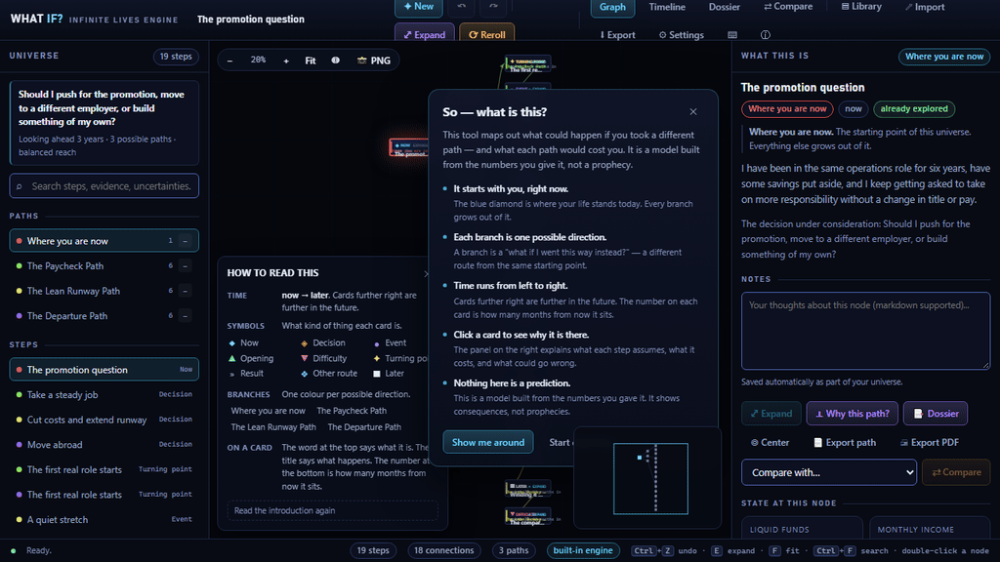
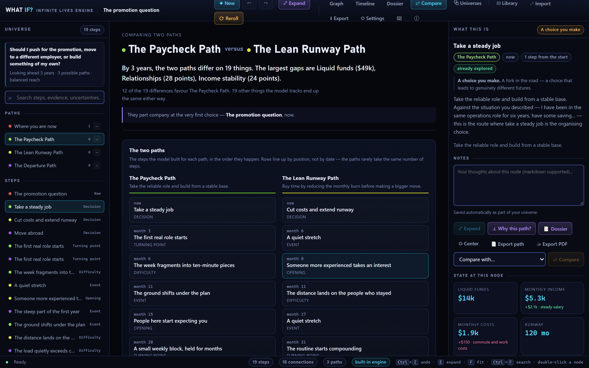
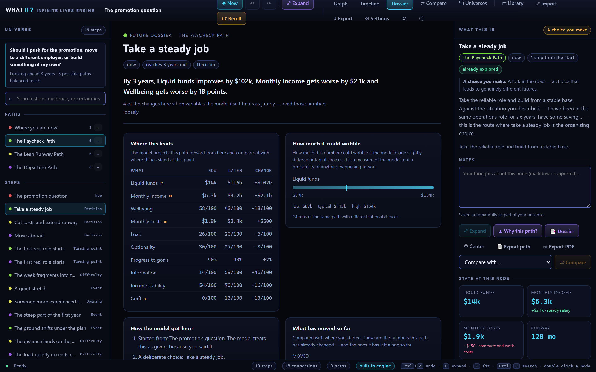
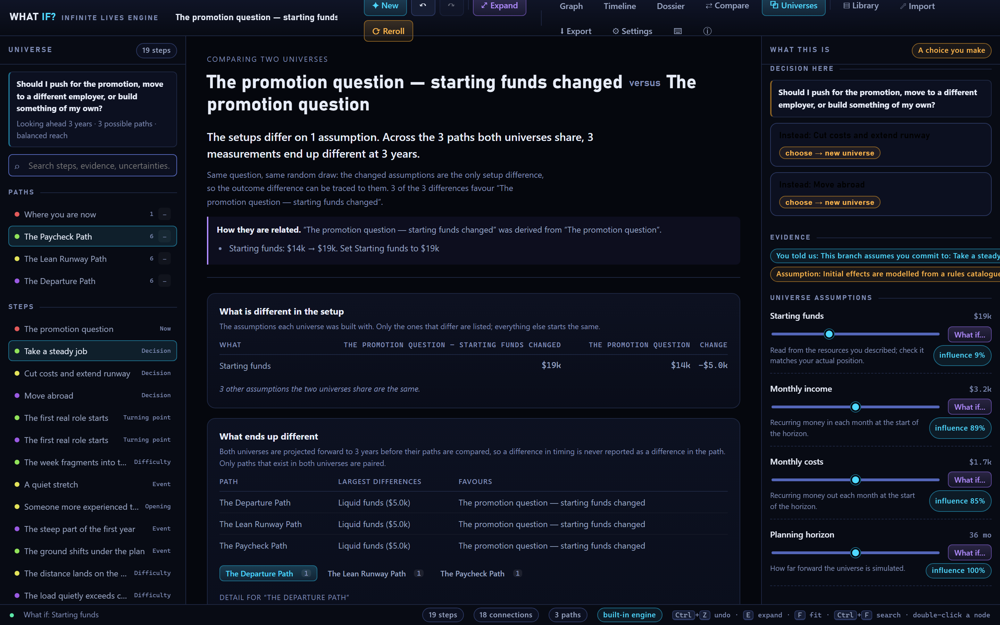
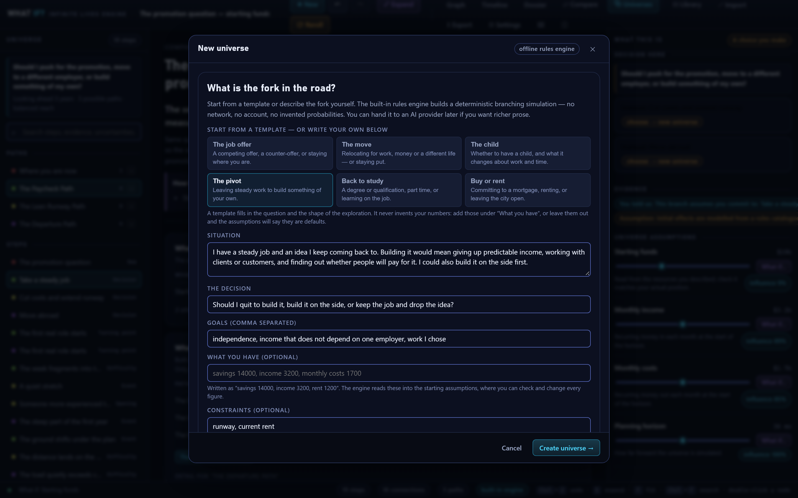

# What If? — The Infinite Lives Engine

[](https://github.com/CypherMorgan/what-if-infinite-lives-engine/releases/latest)
[](https://github.com/CypherMorgan/what-if-infinite-lives-engine/releases)
[](https://github.com/CypherMorgan/what-if-infinite-lives-engine/stargazers)
[](https://github.com/CypherMorgan/what-if-infinite-lives-engine/actions/workflows/ci.yml)
[](LICENSE)
[](#requirements)
[](https://www.electronjs.org/)
[](https://react.dev/)
[](https://www.typescriptlang.org/)
[](#testing)
[](#privacy--security)

<p align="center">
  
</p>

<p align="center">
  
</p>

**Think through a big decision by exploring plausible alternatives. Compare them side by side. Take your answer home as a printable PDF.**

A local-first Windows desktop app for mapping alternative life paths through interactive branching timelines, counterfactuals, and a deterministic rules engine. Runs fully offline by default, keeps everything on your machine, and has an optional OpenAI-compatible provider only if you choose to use one.

**[⬇️ Download the latest release](https://github.com/CypherMorgan/what-if-infinite-lives-engine/releases/latest)** — NSIS installer or portable build for Windows 10/11 x64.

## Screenshots

| Multiverse graph                                                               | Node inspector                                                                             |
| ------------------------------------------------------------------------------ | ------------------------------------------------------------------------------------------ |
|  |  |

| Timeline view                                                    | Keyboard shortcuts                                                 |
| ---------------------------------------------------------------- | ------------------------------------------------------------------ |
|  |  |

| Two paths compared                                                  | The dossier                                                       |
| ------------------------------------------------------------------- | ----------------------------------------------------------------- |
|  |  |

| Two universes compared                                                            |
| --------------------------------------------------------------------------------- |
|  |

| Starting from a scenario template                                                                           |
| ----------------------------------------------------------------------------------------------------------- |
|  |

> Screenshots are generated from the real app UI by `npm run screenshots` — they are not mockups.

## Features

- **Interactive multiverse graph** — Pan, zoom, drag nodes, select paths, collapse branches, search, minimap, auto-layout. Animated branch growth with reduced-motion support.
- **Deterministic simulation** — Pure rule-engine model over a typed variable/state system. No fake probabilities or hardcoded guesses. "Model spread" is labelled engine variance, not a real-world forecast.
- **Counterfactuals** — Change any assumption or choose a decision option to fork a new universe. Full lineage (parent/counterfactual metadata), snapshots, diffs, and stability analysis.
- **Compare two paths side by side** — See exactly where they diverge and what ends up different, compared at a common moment. "Favours" is direction, not a recommendation.
- **Compare two universes side by side** — Put a universe and a fork of it next to each other: the origin they share, the assumptions that differ, the paths they both have, and what ends up different. When the two answer different questions or were run with different random draws, it says so instead of blaming the difference on the assumption you changed.
- **Scenario templates** — Six starting points for the questions people actually ask: the job offer, the move, the child, the pivot, back to study, buy or rent. A template fills in the question and the shape of the exploration; it never invents your money. Add your own figures under "What you have" and the starting assumptions are built from them — leave it blank and they are labelled as defaults.
- **Future dossier** — A plain-language brief for any step: where it leads, what it buys/costs, risks, how the model got there, and how much it could wobble.
- **Print or export as PDF** — Turn any path into a clean, self-contained **PDF report** (situation, universe map, dossier, step-by-step, assumptions) with everything escaped and nothing fetched. Also export as **Markdown** or save the graph as **PNG**.
- **Timeline view** — Toggle between the graph and a chronological timeline sorted by elapsed time, with branch colours and per-node tradeoffs.
- **Honest evidence model** — Every node carries evidence tags (`user-fact`, `research`, `assumption`, `speculation`) with provenance so you can tell stated facts from extrapolation.
- **Local-first persistence** — Versioned JSON documents (`schemaVersion: 3`) with migrations, atomic writes, repair-on-import for recoverable issues (dangling edges/unreachable nodes are repaired with notes; structural failures are rejected), and a library index.
- **Import/Export** — Self-contained `.whatif.json` envelope (`format: whatif.universe`) with checksum/hash, schema version, and app version for forward-compatible migration.
- **Node notes** — Attach your own markdown notes to any node; they persist with the universe and appear in path exports.
- **Accessible & keyboard-friendly** — Keyboard navigation, dialog focus management, ARIA landmarks, readable contrast, and works great without a mouse.
- **Privacy by design** — No telemetry, analytics, crash reporting, or accounts. Network access only if you configure an HTTP provider. API keys go through Electron `safeStorage` (DPAPI on Windows), never written to renderer storage, logs, or exports.
- **Windows-native** — Electron app with menus, shortcuts, file dialogs, DPI awareness, NSIS installer + portable build.

## Tech Stack

| Layer           | Technology                                                                                                              | Rationale                                                                                                                                       |
| --------------- | ----------------------------------------------------------------------------------------------------------------------- | ----------------------------------------------------------------------------------------------------------------------------------------------- |
| Desktop shell   | [Electron 44.9.0](https://www.electronjs.org/)                                                                          | Ships a real Windows exe/installer with no C++/.NET/Rust toolchain required on this machine.                                                    |
| UI              | [React 19](https://react.dev/) + [TypeScript 5.9](https://www.typescriptlang.org/) (strict, `noUncheckedIndexedAccess`) | Type-safe, predictable rendering.                                                                                                               |
| Build           | [Vite 7](https://vitejs.dev/)                                                                                           | Fast dev + correct file:// loading (`base: './'`).                                                                                              |
| Packaging       | [electron-builder 26](https://www.electron.build/)                                                                      | NSIS installer + portable Windows builds.                                                                                                       |
| Core/simulation | Hand-written TypeScript                                                                                                 | Deterministic, testable, no native modules (avoids build complexity). Canvas2D graph renderer hand-written for full control over motion/layout. |
| Persistence     | Versioned JSON + migration chain                                                                                        | Atomic writes, portable, auditable.                                                                                                             |

Core modules have no Electron imports so the simulation/graph/AI logic runs in Node for unit tests.

## Requirements

- Windows 10/11 x64
- Node.js 22+ (see [`.nvmrc`](.nvmrc); tested with 26.8.1)
- npm 11+ (tested with 11.19.0)

## Download

**[⬇️ Download the latest release](https://github.com/CypherMorgan/what-if-infinite-lives-engine/releases/latest)** for Windows 10/11 x64:

- **NSIS installer** (`*-Setup-*.exe`) — per-user, choose your install folder, adds Start Menu + desktop shortcuts.
- **Portable build** (`*-Portable-*.exe`) — single file, no installation required. Great for a USB drive.

No runtime, toolchain, or account is needed to run either build.

## Installation & Development

```powershell
# Install dependencies
npm install

# Run in browser (Vite dev server)
npm run dev
# → http://localhost:5199

# Run as desktop app (builds Electron shell first)
npm run dev:desktop

# Typecheck
npm run typecheck

# Lint
npm run lint

# Format (Prettier)
npm run format
npm run format:check

# Run all tests
npm test

# Watch tests
npm run test:watch

# End-to-end smoke tests (Playwright; starts the dev server automatically)
npm run test:e2e

# Regenerate the app icon (build/icon.ico + build/icon-256.png)
npm run icon
npm run icon:verify

# Regenerate the README screenshots (starts the dev server automatically)
npm run screenshots
npm run screenshots:verify
```

## Building for Windows

```powershell
# Build renderer + Electron shell
npm run build

# Create NSIS installer + portable in release/ (no publishing)
npm run dist

# Same as `dist`; used by the release workflow before it uploads artifacts
npm run package:win

# Portable only
npm run dist:portable
```

Outputs:

- `release/what-if-infinite-lives-engine-Setup-<version>-x64.exe` — NSIS installer
- `release/what-if-infinite-lives-engine-Portable-<version>-x64.exe` — single-file portable build
- `release/win-unpacked/` — unpacked application directory (used while packaging)

Both artifacts are produced by a single `npm run dist`. Releases are published automatically by [`.github/workflows/release.yml`](.github/workflows/release.yml) when a `v*` tag is pushed.

## Project Structure

```
thewhatifs/
├── .github/                  # CI, release workflow, issue/PR templates
├── build/                    # Icon source (icon.ico, icon-256.png)
├── docs/                     # ARCHITECTURE.md, EXPORT_FORMAT.md, screenshots/
├── e2e/                      # Playwright smoke tests
├── electron/                 # Main + preload (contextBridge API)
│   ├── main.ts
│   └── preload.ts
├── scripts/                  # Build helpers (icon generator, screenshot capture)
├── src/
│   ├── ai/                   # Provider interface, offline/HTTP adapters, orchestrator, schema
│   ├── core/                 # Engine, graph, layout, rules, counterfactuals, dossier, migration/import/export
│   │   ├── packs/            # Rule packs + variables
│   │   └── ...
│   ├── ui/                   # React app, Canvas renderer, state store, theme
│   │   ├── components/
│   │   ├── graph/
│   │   ├── state/
│   │   └── theme.css
│   ├── main.tsx
│   └── ui/App.tsx
└── tests/                    # 326 unit tests (engine, counterfactual, persistence, export format, AI, update, vars, dossier, branch diff, universe diff, templates, PDF report, store, accessibility)
```

## Usage

1. **Create a universe** (`Ctrl+N`) — Start from a scenario template or describe your own situation and the decision in front of you. Add what you have (`savings 14000, income 3200`) and the engine reads those figures into the assumptions; the form also shows which rule packs your words activated. The offline engine then generates a branching simulation deterministically.
2. **Navigate** — Click nodes to inspect. Use arrow keys to move along paths, `E` to expand, mouse to pan/zoom/drag.
3. **Expand** — `Expand` generates the next plausible steps from a node using the rule catalogue.
4. **Counterfactuals** — Tweak assumptions in the inspector or use "What if…" to fork a new universe. Choose decision options to explore alternatives.
5. **Compare** — Compare any two paths inside a universe, or press `⧉ Universes` to put the open universe beside a saved fork and see which assumptions differ and what they moved.
6. **Import/Export** — `Ctrl+S` / `Ctrl+O` to save/load `.whatif.json` files. Universes are also auto-saved to your library. Any single path can also be exported as a **Markdown report** or a **printable PDF** (`🖨 Export PDF` in the inspector, or from the dossier).
7. **Settings** — Configure an OpenAI-compatible provider (base URL/model/keyless). Keys are stored encrypted via `safeStorage` in the app data folder.

## Keyboard Shortcuts

| Shortcut                  | Action                      |
| ------------------------- | --------------------------- |
| `Ctrl+N`                  | New universe                |
| `Ctrl+O`                  | Import                      |
| `Ctrl+S`                  | Export                      |
| `Ctrl+Z` / `Ctrl+Shift+Z` | Undo / Redo                 |
| `Ctrl+F`                  | Fit to view                 |
| `Ctrl+/`                  | Keyboard shortcuts          |
| `E`                       | Expand selected node        |
| `F`                       | Fit to view                 |
| `+` / `-`                 | Zoom in / out               |
| `↑/↓/←/→`                 | Navigate to parent/child    |
| `Esc`                     | Clear selection/close modal |

## Testing

All core logic is covered by unit tests (326 passing):

- **engine.test.ts** — Determinism, expansion, layout, queries, forecast/spread, rule catalogue, derive clamping
- **counterfactual.test.ts** — Assumption/decision counterfactuals, lineage, reroll, snapshots/diffs/stability
- **persistence.test.ts** — Export envelope round-trip, all typed import failures, v1→v3 migrations
- **exportFormat.test.ts** — The documented `.whatif.json` contract, and what a hand-written file may omit
- **ai.test.ts** — JSON extraction/parse, HTTP provider (fallback/strict/redaction/cancellation), document coercion
- **update.test.ts** — Release-channel parsing, version comparison, pre-release and draft exclusion
- **vars.test.ts** — Variable registry integrity (no duplicate keys)
- **dossier.test.ts** — Dossier construction, determinism, ordering, honesty of the prose
- **branchDiff.test.ts** — Comparing two paths: the common moment, the divergence point, and which way "favours" points
- **universeDiff.test.ts** — Comparing two universes: lineage, one-sided assumptions, path pairing by name, and the cases where a difference must not be blamed on the changed assumption
- **templates.test.ts** — Scenario templates: every card builds a real deterministic universe, activates the rule pack its words imply, and never puts invented money in the user's mouth
- **pdfReport.test.ts** — The printable report: it is complete, deterministic, and nothing the user typed can escape into the markup
- **store.test.ts** — Selection, camera, expansion, undo/redo, branches, assumptions, import/export, settings, template figures, and returning to the graph when the open universe changes
- **accessibility.test.ts** — Colour contrast against the palette, and the markup that a screen reader depends on

End-to-end smoke tests live in `e2e/` and run with Playwright:

```powershell
npm run test:e2e
```

### Quality tooling

- **TypeScript** — `strict` and `noUncheckedIndexedAccess`; run `npm run typecheck`.
- **ESLint** — flat config with `typescript-eslint`; run `npm run lint`.
- **Prettier** — formatting via `npm run format` / `npm run format:check`.
- **Commitlint + Husky** — conventional-commit messages and a pre-commit typecheck/lint hook.
- **Error boundaries** — the app and its panels fail soft with a recoverable UI.

### Accessibility

The app is built to be usable without a mouse and legible on a low-contrast
screen. It is not certified against a particular accessibility standard — no
audit was carried out with a screen reader or with people who use one — but
the following are implemented and covered by `tests/accessibility.test.ts`:

- **Every control has an accessible name.** Buttons that are only a symbol
  carry an `aria-label`; the on/off switches take their name from the same
  string as their visible label, so the two cannot drift apart.
- **Dialogs behave.** Focus moves into a dialog when it opens, lands on the
  field you would want to type into, stays inside while it is open, and
  returns to the control that opened it when it closes. `Esc` closes a dialog
  from anywhere inside it, including from a text field.
- **One `h1`, no skipped levels.** The app name is the only `h1`; every panel
  and card titles itself underneath it.
- **Landmarks.** The graph, the timeline, the dossier and the comparison are
  `main` regions; the two side panels are `aside`s. The canvas describes
  itself in words and the same steps are listed as text beside it.
- **Contrast.** Every text colour clears 4.5:1 against every surface it is
  used on, and the outline of a control clears 3:1 against the background
  behind it.
- **A visible focus ring** on anything a keyboard can reach, in the same
  colour everywhere.

## Documentation

- **[docs/EXPORT_FORMAT.md](docs/EXPORT_FORMAT.md)** — the `.whatif.json` format, in full: the envelope, every field of the document, the migration chain, the validation and repair rules, the limits, and what the PDF path report contains.
- **[docs/ARCHITECTURE.md](docs/ARCHITECTURE.md)** — how the engine, the renderer, the persistence layer and the AI bridge fit together.
- **[ROADMAP.md](ROADMAP.md)** — what has shipped, what is being built, and what is deliberately not planned.
- **[CHANGELOG.md](CHANGELOG.md)** — every release, with the reasoning behind the notable fixes.

## Privacy & Security

- **Offline by default** — No network calls unless a provider is configured.
- **No telemetry** — Nothing is collected or sent.
- **Secrets** — API keys encrypted with Windows DPAPI via `safeStorage`, stored in `secrets/` under the app data directory. Never persisted in renderer localStorage or exports.
- **Sandboxed renderer** — `contextIsolation: true`, `nodeIntegration: false`, CSP in `index.html`, navigation/permissions blocked.
- **Local data** — Universes live in `localStorage` and app data; fully user-controlled.

## License

```
MIT License

Copyright (c) 2026

Permission is hereby granted, free of charge, to any person obtaining a copy
of this software and associated documentation files (the "Software"), to deal
in the Software without restriction, including without limitation the rights
to use, copy, modify, merge, publish, distribute, sublicense, and/or sell
copies of the Software, and to permit persons to whom the Software is
furnished to do so, subject to the following conditions:

The above copyright notice and this permission notice shall be included in all
copies or substantial portions of the Software.

THE SOFTWARE IS PROVIDED "AS IS", WITHOUT WARRANTY OF ANY KIND, EXPRESS OR
IMPLIED, INCLUDING BUT NOT LIMITED TO THE WARRANTIES OF MERCHANTABILITY,
FITNESS FOR A PARTICULAR PURPOSE AND NONINFRINGEMENT. IN NO EVENT SHALL THE
AUTHORS OR COPYRIGHT HOLDERS BE LIABLE FOR ANY CLAIM, DAMAGES OR OTHER
LIABILITY, WHETHER IN AN ACTION OF CONTRACT, TORT OR OTHERWISE, ARISING FROM,
OUT OF OR IN CONNECTION WITH THE SOFTWARE OR THE USE OR OTHER DEALINGS IN THE
SOFTWARE.
```
